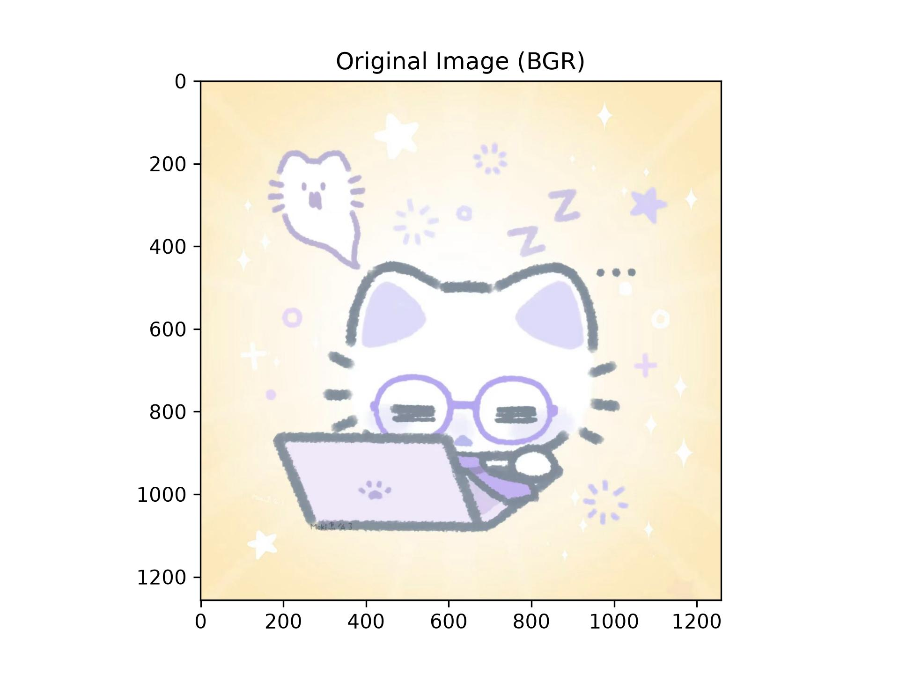
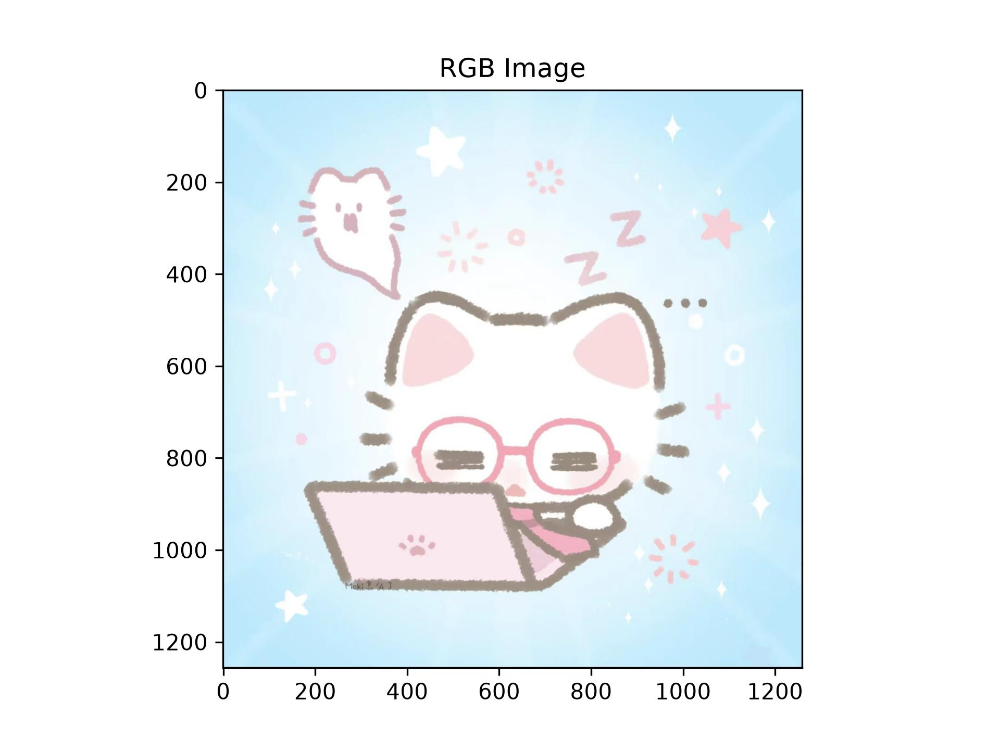
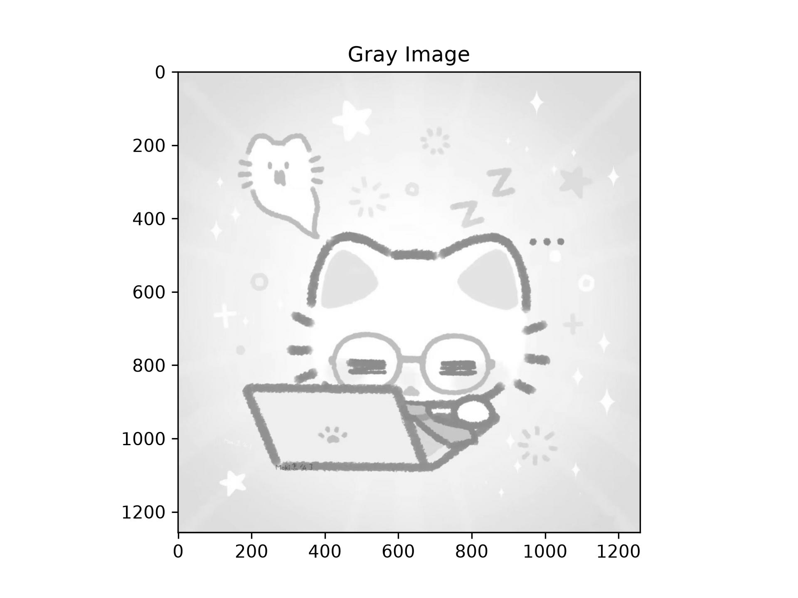
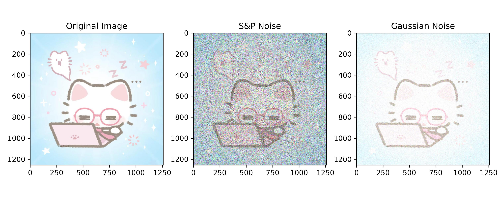
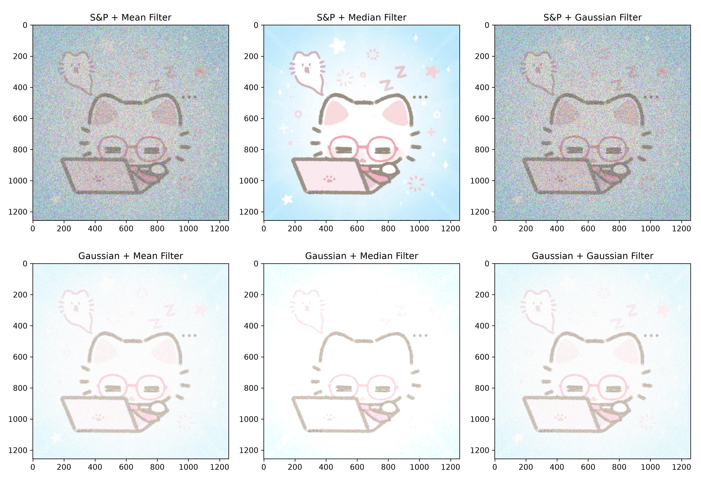
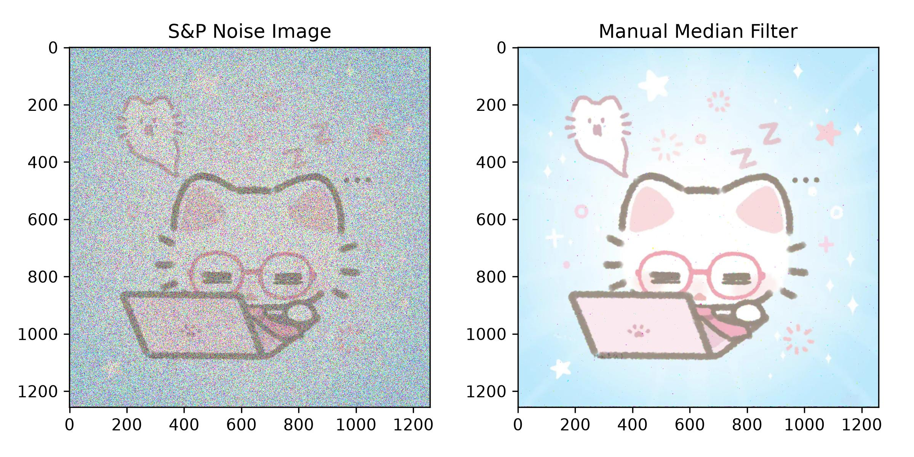

# 实验二：图像增强

### 202410315032-人工智能241-梁旭

## 一、实验目的

#### 1. 熟悉 OpenCV 库的基础调用方式，掌握图像读取、色彩空间转换、结果可视化的完整流程。
#### 2. 理解椒盐噪声、高斯噪声两类典型图像噪声的生成原理与视觉特征差异，掌握噪声添加方法。
#### 3. 对比均值滤波、中值滤波、高斯滤波三种经典算法的去噪效果，总结不同算法的适用场景与优劣。
#### 4. 通过手动编码实现彩色图像中值滤波，深入理解邻域滤波的底层逻辑，掌握多通道图像处理的基本思想。学会OpenCV的基本使⽤⽅法，利⽤OpenCV等计算机库对图像进⾏平滑、滤波等操作，实现图像增强。

## 二、实验环境与素材

#### 开发平台：Python 3.12 + Jupyter Notebook
#### 依赖库：OpenCV（核心图像处理）、scikit-image（噪声生成）、NumPy（矩阵运算）、Matplotlib（绘图与结果保存）
#### 测试素材：本地彩色图像 cat.jpg

## 三、实验内容与步骤

### 3.1 基础环境搭建与图像读取

#### 1.导⼊图像滤波相关的依赖包

OpenCV 库：计算机视觉与图像处理
scikit-image 库：图像增强与分析，`random_noise` 用于给图像添加噪声
NumPy 库：科学计算的基础库
Matplotlib 库：绘图与数据可视化

```
import cv2
from skimage.util import random_noise
import numpy as np
from matplotlib import pyplot as plt
```

#### 2.读取原始图像
使用 OpenCV 读取本地 cat.jpg 图像（OpenCV 默认以 BGR 通道顺序存储图像），提取并打印坐标 (100, 100) 处的 BGR 像素通道值。直接用 Matplotlib 显示 BGR 格式图像，观察通道顺序不匹配导致的偏色现象。
```
img = cv2.imread('cat.jpg')

# 获取像素点 (100, 100) 的 BGR 值
(b, g, r) = img[100, 100]
print('Pixel (100,100) BGR:', b, g, r)

plt.imshow(img)
plt.title('Original Image (BGR)')
plt.savefig('result/original_bgr.jpg', dpi=300)
plt.show()
```

```
输出：Pixel (100,100) BGR: 253 236 197
```


### 3.2 色彩空间转换

#### 1. BGR 格式转 RGB 格式
将 OpenCV 默认的 BGR 格式转换为 RGB 格式，匹配 Matplotlib 的显示通道顺序，还原图像真实色彩并保存结果。
```
# BGR → RGB
rgb_img = cv2.cvtColor(img, cv2.COLOR_BGR2RGB)
plt.imshow(rgb_img)
plt.title('RGB Image')
plt.savefig('result/rgb_image.jpg', dpi=300)
plt.show()
```

#### 2. 彩色图像转灰度图
将 BGR 格式的彩色图像转换为单通道灰度图，去除色彩信息，仅保留亮度维度，简化后续算法的计算量。
```
# BGR → Gray
gray_img = cv2.cvtColor(img, cv2.COLOR_BGR2GRAY)
plt.imshow(gray_img, cmap='gray')
plt.title('Gray Image')
plt.savefig('result/gray_image.jpg', dpi=300)
plt.show()
```


### 3.3 图像噪声模拟

在 RGB 原图基础上生成两类典型噪声：
1. 椒盐噪声：设置噪声占比 40%，模拟随机出现的黑白脉冲噪点。
2. 高斯噪声：设置均值 0.2、方差 0.03，模拟服从正态分布的全局亮度扰动。
将原图与两类噪声图横向排列展示，直观对比噪声的视觉差异。

```
# 椒盐噪声
sp_noise_img = random_noise(rgb_img, mode='s&p', amount=0.4)

# 高斯噪声
gus_noise_img = random_noise(rgb_img, mode='gaussian', mean=0.2, var=0.03)

plt.figure(figsize=(10, 4))

plt.subplot(1, 3, 1)
plt.imshow(rgb_img)
plt.title('Original Image')

plt.subplot(1, 3, 2)
plt.imshow(sp_noise_img)
plt.title('S&P Noise')

plt.subplot(1, 3, 3)
plt.imshow(gus_noise_img)
plt.title('Gaussian Noise')

plt.tight_layout()
plt.savefig('result/noise_comparison.jpg', dpi=300)
plt.show()
```


### 3.4 经典滤波算法去噪实验

分别对椒盐噪声、高斯噪声图像应用三种滤波算法：
1. 均值滤波：采用 5×5 邻域窗口，以邻域像素平均值作为输出。
2. 中值滤波：采用 5×5 窗口，以邻域像素排序后的中值作为输出，需先将 0-1 范围的浮点型噪声图转换为 0-255 范围的 uint8 格式。
3. 高斯滤波：采用 5×5 高斯核，按像素距离加权平均，标准差由函数自动计算。
将 6 组处理结果排列为 2 行 3 列的对比图，统一保存。
```
# 均值滤波
mean_sp = cv2.blur(sp_noise_img, (5, 5))
mean_gus = cv2.blur(gus_noise_img, (5, 5))

# 中值滤波（需 uint8）
mid_sp = cv2.medianBlur((sp_noise_img * 255).astype(np.uint8), 5)
mid_gus = cv2.medianBlur((gus_noise_img * 255).astype(np.uint8), 5)

# 高斯滤波
gauss_sp = cv2.GaussianBlur((sp_noise_img * 255).astype(np.uint8), (5, 5), 0)
gauss_gus = cv2.GaussianBlur((gus_noise_img * 255).astype(np.uint8), (5, 5), 0)
```
```
plt.figure(figsize=(13, 9))

# 椒盐噪声
plt.subplot(2, 3, 1)
plt.imshow(mean_sp)
plt.title('S&P + Mean Filter')

plt.subplot(2, 3, 2)
plt.imshow(mid_sp)
plt.title('S&P + Median Filter')

plt.subplot(2, 3, 3)
plt.imshow(gauss_sp)
plt.title('S&P + Gaussian Filter')

# 高斯噪声
plt.subplot(2, 3, 4)
plt.imshow(mean_gus)
plt.title('Gaussian + Mean Filter')

plt.subplot(2, 3, 5)
plt.imshow(mid_gus)
plt.title('Gaussian + Median Filter')

plt.subplot(2, 3, 6)
plt.imshow(gauss_gus)
plt.title('Gaussian + Gaussian Filter')

plt.tight_layout()
plt.savefig('result/filter_results_2x3.jpg', dpi=300)
plt.show()
```


### 3.5 手动实现中值滤波

自主编写函数实现彩色图像中值滤波：对图像边缘采用复制填充避免边界信息丢失；对 R、G、B 三个通道独立遍历，逐个像素提取邻域窗口并计算中值。
最终将手动滤波结果与带噪原图对比，验证算法有效性。
```
def manual_median_filter_color(image, kernel_size=5):
    """
    手动实现彩色图像的中值滤波
    image: 输入彩色图像 (H, W, 3)
    kernel_size: 滤波窗口大小
    """
    pad = kernel_size // 2
    filtered_img = np.zeros_like(image)

    for c in range(3):
        channel = image[:, :, c]
        padded = np.pad(channel, pad_width=pad, mode='edge')
        for i in range(channel.shape[0]):
            for j in range(channel.shape[1]):
                region = padded[i:i+kernel_size, j:j+kernel_size]
                filtered_img[i, j, c] = np.median(region)

    return filtered_img
```
```
manual_mid = manual_median_filter_color((sp_noise_img * 255).astype(np.uint8), kernel_size=5)

plt.figure(figsize=(8, 4))

plt.subplot(1, 2, 1)
plt.imshow(sp_noise_img)
plt.title('S&P Noise Image')

plt.subplot(1, 2, 2)
plt.imshow(manual_mid)
plt.title('Manual Median Filter')

plt.tight_layout()
plt.savefig('result/manual_median.jpg', dpi=300)
plt.show()
```


## 四、实验结果与分析

### 4.1 色彩空间转换结果分析

直接显示 BGR 格式图像时，画面出现明显的红蓝反转偏色，这是由于 Matplotlib 按 RGB 顺序解析像素通道，与 OpenCV 的 BGR 存储顺序相反。完成格式转换后，图像色彩恢复正常，符合人眼视觉认知。
灰度图像剥离了色彩信息，仅通过明暗灰度呈现图像轮廓与纹理，能够简化计算量，是多数底层图像处理算法的标准输入格式。

### 4.2 噪声特征对比分析

椒盐噪声属于脉冲型噪声，表现为图像中随机分布的孤立黑白点，对局部画面的遮挡性强，噪声点与周围像素差异极大。
高斯噪声属于加性连续噪声，表现为整体画面的颗粒感抖动，所有像素都发生轻微的亮度偏移，没有极端的极值点，画质呈现全局性下降。
两者本质区别在于：椒盐噪声是像素值的随机替换（极值突变），高斯噪声是像素值的随机偏移（连续分布），这一特性直接决定了适配的去噪算法不同。

### 4.3 滤波算法效果分析

1. 值滤波
对高斯噪声有较好的平滑效果，邻域平均可以抵消正负方向的随机扰动，让画面整体趋于柔和；但对椒盐噪声处理效果很差，黑白极值点会参与平均运算，导致噪点变为模糊的斑块，无法彻底清除，同时图像边缘与细节会被明显模糊。
2. 中值滤波
对椒盐噪声的去除效果最为突出，几乎可以完全消除孤立的黑白噪点。原因在于椒盐噪声的极值点在邻域排序中处于两端，不会被选为中值，因此去噪同时能较好保留边缘与纹理细节。对高斯噪声也有一定抑制作用，但平滑自然度不如线性滤波，画面会残留轻微颗粒感。
3. 高斯滤波
对高斯噪声的去除效果最优，基于距离的加权平均方式让中心像素权重更高，相比均值滤波更好地保留了边缘信息，去噪后画面过渡自然，模糊程度更低。但面对椒盐噪声这种突变极值时，加权平均依然会受极值点干扰，无法彻底清除噪点。

### 4.4 手动实现滤波结果分析

自主编写的彩色中值滤波函数，去噪效果与 OpenCV 内置 API 基本一致，能够有效消除椒盐噪声，同时保持色彩真实、边缘清晰。
实现过程中验证了彩色图像处理的基本原则：不能直接对三维像素矩阵整体取中值，必须对三个通道独立运算，否则会出现色彩串扰与失真。同时边缘填充是必要步骤，否则图像四周无法形成完整滤波窗口，会出现边缘信息缺失。

## 五、实验总结与体会

本次实验围绕图像增强与滤波去噪主题展开，完整完成了图像读取与像素信息提取、色彩空间格式转换、典型图像噪声模拟、多种经典滤波算法对比测试，以及彩色图像中值滤波的手动编码实现等全部实验环节。
通过实验，我熟练掌握了 OpenCV 库读取本地图像、提取指定坐标像素值的基本方法，理清了 RGB 与 BGR 两种通道存储格式的区别，理解了不同色彩空间的应用场景，也掌握了彩色图像向灰度图像转换的方法与实际意义。在噪声模拟环节，我学会了使用 scikit-image 库为图像添加椒盐噪声与高斯噪声，直观认识了两类噪声的生成机制与视觉表现差异，明确了椒盐噪声属于脉冲型极值噪声、高斯噪声属于加性连续噪声的本质区别。在滤波去噪的对照实验中，我系统掌握了均值滤波、中值滤波、高斯滤波三种经典算法的调用方式与核心原理，通过对比效果总结出了算法适配规律。中值滤波作为非线性滤波，对椒盐噪声这类孤立极值点有出色的去除能力，同时能较好保留图像边缘细节。均值滤波与高斯滤波作为线性滤波，对高斯噪声的平滑抑制效果更佳，其中高斯滤波凭借距离加权的特性，在去噪同时能更好地保留画面边缘信息。手动编写彩色图像中值滤波函数的过程，让我深入理解了邻域滤波的底层执行逻辑，切实掌握了图像边界填充、多通道独立遍历处理、邻域窗口像素排序取中值等核心实现方法，也验证了彩色图像处理中逐通道运算的必要性。
