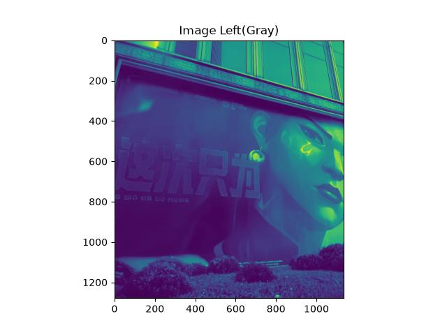
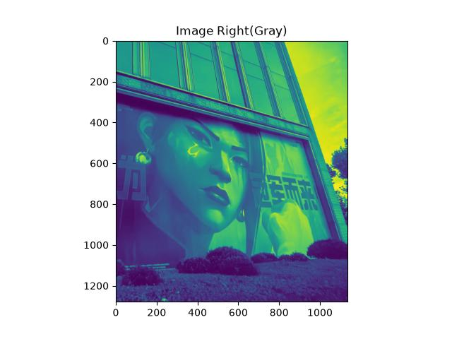

# 实验三：图像关键点检测与图像拼接

### 202410315032-人工智能241-梁旭

## 一、实验目的
1. 理解基于局部特征的图像配准与拼接流程，认识关键点、特征描述子与匹配点对的作用。
2. 掌握 SIFT特征检测与描述方法，并使用 FLANN 进行近邻匹配。
3. 掌握 Lowe 比率测试筛选候选匹配点的方法，以及 RANSAC 估计单应性矩阵的基本原理。
4. 理解 RANSAC 算法的基本思想，利用匹配点之间的几何一致性估计单应性矩阵，并对比几何筛选前后的匹配效果。
5. 熟悉 OpenCV 中透视变换与图像拼接的实现，分析拼接效果。

## 二、实验环境与素材
#### 开发平台：Python 3.12 + Jupyter Notebook

#### 依赖库：OpenCV（SIFT 特征检测、FLANN 特征匹配、RANSAC 单应性矩阵估计及图像拼接）、NumPy（矩阵运算与坐标变换）、Matplotlib（图像可视化与结果保存）

#### 测试素材：本地彩色图像 left.jpg 和 right.jpg，两幅具有重叠区域的建筑场景图像，用于特征匹配与图像拼接实验。

## 三、实验内容与步骤

### 3.1 图像读取和预处理
首先使用 `cv2.imread()` 读取左右两幅输入图像，并通过 `cv2.cvtColor(..., cv2.COLOR_BGR2RGB)` 将 OpenCV 默认的 BGR 通道顺序转换为 RGB，以便后续通过 Matplotlib 显示彩色图像。随后生成灰度图并保存原图、灰度图的可视化结果。

```
img_a = cv2.cvtColor(cv2.imread("img/left.jpg"), cv2.COLOR_BGR2RGB)
img_b = cv2.cvtColor(cv2.imread("img/right.jpg"), cv2.COLOR_BGR2RGB)

gray_a = cv2.cvtColor(img_a, cv2.COLOR_BGR2GRAY)
gray_b = cv2.cvtColor(img_b, cv2.COLOR_BGR2GRAY)
```

| 图1(a) 左图灰度数据的显示结果 | 图1(b) 右图灰度数据的显示结果 |
|:---:|:---:|
|  |  |

### 3.2 SIFT 特征提取与关键点可视化
创建 SIFT 检测器，对左右两幅图像分别提取关键点及描述子。

```
sift = cv2.SIFT_create()
kp_a, des_a = sift.detectAndCompute(img_a, None)
kp_b, des_b = sift.detectAndCompute(img_b, None)

vis_a = cv2.drawKeypoints(
    img_a, kp_a, None,
    flags=cv2.DRAW_MATCHES_FLAGS_DRAW_RICH_KEYPOINTS
)
vis_b = cv2.drawKeypoints(
    img_b, kp_b, None,
    flags=cv2.DRAW_MATCHES_FLAGS_DRAW_RICH_KEYPOINTS
)
```


从上图可见，两幅图像的建筑线条、人物五官、文字边缘以及草地纹理区域均检测到了关键点,部分较平坦的区域关键点相对稀疏。关键点分布反映了 SIFT 更容易在局部梯度变化明显的位置提取具有区分度的特征。

### 3.3 FLANN 特征匹配
使用 FLANN 寻找描述子的两个近邻，并按基准阈值 $r=0.7$ 进行 Lowe 比率筛选.

```
FLANN_INDEX_KDTREE = 1
index_params = dict(algorithm=FLANN_INDEX_KDTREE, trees=5)
search_params = dict(checks=50)

flann = cv2.FlannBasedMatcher(index_params, search_params)
matches = flann.knnMatch(des_a, des_b, k=2)

good_matches = []
for m, n in matches:
    if m.distance < 0.7 * n.distance:
        good_matches.append(m)
```

通过 `cv2.drawMatches()` 绘制候选匹配点之间的连线，检查两幅图像在共有区域中的特征对应情况。


### 3.4 Lowe 比率阈值对比实验

为分析比率阈值对匹配结果的影响，补充测试 $r=0.6、0.7、0.8、0.9$ 四组参数。每组实验均基于相同的 SIFT 描述子和 FLANN 最近邻搜索结果重新筛选候选匹配，再使用相同的 RANSAC 基准阈值估计单应性矩阵，统计候选匹配数量及几何内点数量。

实验生成候选匹配数与 RANSAC 内点数随 Lowe 比率变化的曲线：


从上图可以看出，比率阈值从 0.6 增大到 0.9 时，候选匹配数量持续增加。而 RANSAC 内点数量的增幅相对有限，特别是在较高阈值区间，两者增长速度的差异更加明显。这说明放宽 Lowe 比率条件可以获得更多匹配，但其中可能包含更多不满足同一单应性关系的匹配。因而阈值选择需要在候选匹配数量和几何一致性之间取得平衡，不能仅依据候选匹配的绝对数量作出判断。

### 3.5 RANSAC 单应性估计与筛选前后对比

根据 `good_matches` 中的索引提取对应点坐标，将右图特征点作为源点、左图特征点作为目标点，并通过 RANSAC 估计单应性矩阵：

```
src_pts = np.float32([
    kp_b[m.trainIdx].pt for m in good_matches
]).reshape(-1, 1, 2)

dst_pts = np.float32([
    kp_a[m.queryIdx].pt for m in good_matches
]).reshape(-1, 1, 2)

H, mask = cv2.findHomography(
    src_pts, dst_pts, cv2.RANSAC, 5.0
)
```

利用 `mask` 对比 RANSAC 筛选前后的匹配点连线：


从上图可见，经过 RANSAC 筛选后，匹配连线数量有所减少，保留下来的匹配点在空间投影关系上具有更好的一致性。这说明仅靠描述子距离进行筛选仍不充分，有必要进一步利用图像之间的几何约束剔除不符合单应性模型的候选点。

### 4.6 计算拼接画布与透视变换

将右图四角经单应性矩阵变换后的坐标与左图四角合并，计算输出画布边界。构造平移矩阵后，将右图透视变换到公共坐标系，再把左图覆盖到其对应位置：

```
translation_matrix = np.array([
    [1, 0, -x_min],
    [0, 1, -y_min],
    [0, 0, 1]
], dtype=np.float32)

fus_img = cv2.warpPerspective(
    img_b,
    translation_matrix @ H,
    (x_max - x_min, y_max - y_min)
)

fus_img[-y_min:h_a-y_min, -x_min:w_a-x_min] = img_a
```


## 四、实验结果与分析

### 4.1 特征匹配统计
Notebook 中的实际运行输出如下：

| 指标 | 实验结果 |
|:---|---:|
| 初始近邻匹配点对数 | **1944** |
| Lowe 比率筛选后保留数 | **979** |
| 被筛除的匹配点对数 | **965** |
| 候选匹配保留比例 | **50.36%** |
| 比率测试阈值 | 0.7 |
| RANSAC 重投影阈值 | 5.0 像素 |

由统计可知，1944 组近邻匹配中有 979 组满足比率测试要求，筛除比例为约 **49.64%**。
### 4.2 SIFT 特征点分布分析
结合图2，SIFT 能在图片中具有明显局部结构的区域提取较多关键点，例如建筑边缘、宣传画文字轮廓、人物眼部和草坪纹理。两幅图像的共有区域包含可重复出现的局部特征，为建立对应关系提供了基础。与此同时，关键点数量多并不意味着一定能够成功拼接。如果纹理重复、图像模糊或两张图重叠不足，仍可能出现错误对应关系，因此需要匹配筛选与几何验证共同发挥作用。

### 4.3 影响拼接质量的因素

首先，图像之间应具有足够的重叠区域，并包含能够稳定检测的角点和纹理；重复结构可能增加局部匹配歧义。其次，FLANN 的搜索参数与 Lowe 比率阈值会共同影响候选匹配数量和可靠性，阈值减小通常会使筛选更严格，但也可能减少可用于估计的对应点。再次，RANSAC 阈值影响内点判定，过小容易剔除有噪声的有效点，过大则可能接纳错误匹配。最后，单应性矩阵适用于满足单应关系的场景，不一定能准确描述明显视差或多深度层次的物体。

## 五、实验小结

本次实验围绕两幅具有重叠区域的场景图像，使用 Python 和 OpenCV 完成了从图像读取与预处理、SIFT 特征提取、FLANN 近邻匹配、Lowe 比率筛选，到 RANSAC 单应性矩阵估计和透视变换拼接的完整流程。在实际运行中，共获得 1944 组初始近邻匹配，经过阈值为 0.7 的 Lowe 比率测试后保留了 979 组候选匹配，保留比例为 50.36%。从最终拼接结果来看，原本分布在两幅图像中的人物宣传画、建筑结构以及周围的绿化区域能够较好地组合在同一幅图像中，扩大了原始图像的视野范围，完成了图像的拼接。

在实验过程中，我不仅完成了基本的图像拼接，还通过增加 SIFT 特征点可视化、Lowe 比率阈值对比以及 RANSAC 筛选前后对比，进一步分析了不同算法在图像拼接过程中的作用。通过观察 SIFT 特征点分布图，我发现特征点通常集中在人物五官、建筑边缘和纹理较为丰富的区域，而在颜色变化较小、纹理较为平坦的区域分布相对稀疏。这使我更加直观地理解了 SIFT 算法提取局部特征的特点。在 Lowe 比率阈值对比实验中，通过分别设置 0.6、0.7、0.8 和 0.9 等不同阈值，我发现随着阈值增大，保留的候选匹配点数量逐渐增加，但 RANSAC 内点数量并不会以相同的速度增长。这说明匹配点数量多并不一定代表匹配效果更好，还需要考虑匹配点之间的几何一致性。因此，在实际应用中，需要根据图像特点合理选择参数，而不能单纯追求更多的匹配点。
