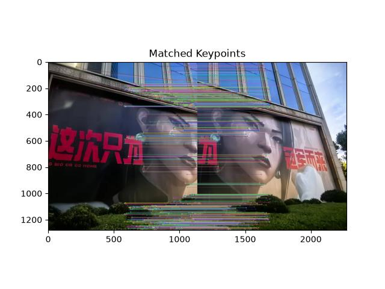
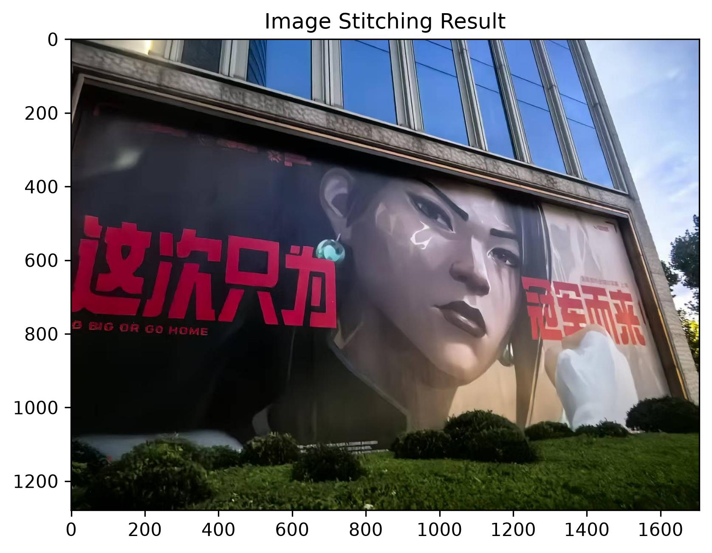

# 实验三：图像关键点检测与图像拼接

### 202410315032-人工智能241-梁旭

## 一、实验目的
1. 理解基于局部特征的图像配准与拼接流程，认识关键点、特征描述子与匹配点对的作用。
2. 掌握 SIFT特征检测与描述方法，并使用 FLANN 进行近邻匹配。
3. 掌握 Lowe 比率测试筛选候选匹配点的方法，以及 RANSAC 估计单应性矩阵的基本原理。
4. 熟悉 OpenCV 中透视变换与图像拼接的实现，分析拼接效果及直接覆盖融合的局限性。

## 二、实验环境与素材
#### 开发平台：Python 3.12 + Jupyter Notebook

#### 依赖库：OpenCV（SIFT 特征检测、FLANN 特征匹配、RANSAC 单应性矩阵估计及图像拼接）、NumPy（矩阵运算与坐标变换）、Matplotlib（图像可视化与结果保存）

#### 测试素材：本地彩色图像 left.jpg 和 right.jpg，两幅具有重叠区域的建筑场景图像，用于特征匹配与图像拼接实验。

## 三、实验内容与步骤

### 3.1 图像读取和预处理

首先使用 `cv2.imread()` 读取左右两幅输入图像，并通过 `cv2.cvtColor(..., cv2.COLOR_BGR2RGB)` 将 OpenCV 默认的 BGR 通道顺序转换为 RGB，以便后续通过 Matplotlib 显示彩色图像。随后生成灰度图并保存原图、灰度图的可视化结果。

```
img_a = cv2.cvtColor(cv2.imread("img/left.jpg"), cv2.COLOR_BGR2RGB)
img_b = cv2.cvtColor(cv2.imread("img/right.jpg"), cv2.COLOR_BGR2RGB)

gray_a = cv2.cvtColor(img_a, cv2.COLOR_BGR2GRAY)
gray_b = cv2.cvtColor(img_b, cv2.COLOR_BGR2GRAY)
```

| 图1(a) 左图灰度数据的显示结果 | 图1(b) 右图灰度数据的显示结果 |
|:---:|:---:|
|  |  |

### 3.2 SIFT 特征提取与 FLANN 匹配

运行 SIFT 算法获取关键点及描述子，使用 FLANN 寻找两个最近邻匹配，再通过阈值为 0.7 的比率测试，得到候选匹配点对。

```
sift = cv2.SIFT_create()
kp_a, des_a = sift.detectAndCompute(img_a, None)
kp_b, des_b = sift.detectAndCompute(img_b, None)

index_params = dict(algorithm=1, trees=5)  # FLANN_INDEX_KDTREE = 1
search_params = dict(checks=50)
flann = cv2.FlannBasedMatcher(index_params, search_params)
matches = flann.knnMatch(des_a, des_b, k=2)

good_matches = []
for m, n in matches:
    if m.distance < 0.7 * n.distance:
        good_matches.append(m)
```

通过 `cv2.drawMatches()` 将保留下来的对应点以连线方式显示。图2中的密集连线主要覆盖建筑边缘、人物面部与绿化区域等具有纹理和结构的部分；匹配点对为下一阶段的几何估计提供输入。



### 3.3 RANSAC 估计单应性矩阵

使用 `queryIdx`、`trainIdx` 分别获取匹配点在左右两幅图像中的坐标，将右图点作为源点、左图点作为目标点，并用 RANSAC 估计透视变换矩阵。

```
src_pts = np.float32(
    [kp_b[m.trainIdx].pt for m in good_matches]
).reshape(-1, 1, 2)

dst_pts = np.float32(
    [kp_a[m.queryIdx].pt for m in good_matches]
).reshape(-1, 1, 2)

H, mask = cv2.findHomography(src_pts, dst_pts, cv2.RANSAC, 5.0)
```

### 3.4 计算画布范围并完成拼接

将右图四角经 `H` 变换后与左图四角合并，计算新的边界范围。使用 `T @ H` 进行透视变换，并在画布对应位置覆盖左图，最后使用 `plt.savefig()` 保存拼接结果。

```
translation_matrix = np.array([
    [1, 0, -x_min],
    [0, 1, -y_min],
    [0, 0, 1]
], dtype=np.float32)

fus_img = cv2.warpPerspective(
    img_b,
    translation_matrix @ H,
    (x_max - x_min, y_max - y_min)
)
fus_img[-y_min:h_a-y_min, -x_min:w_a-x_min] = img_a
```



## 四、实验结果与分析

### 4.1 特征匹配统计

Notebook 中的实际运行输出如下：

| 指标 | 实验结果 |
|:---|---:|
| 初始近邻匹配点对数 | **1944** |
| Lowe 比率筛选后保留数 | **979** |
| 被筛除的匹配点对数 | **965** |
| 候选匹配保留比例 | **50.36%** |
| 比率测试阈值 | 0.7 |
| RANSAC 重投影阈值 | 5.0 像素 |

由统计可知，1944 组近邻匹配中有 979 组满足比率测试要求，筛除比例为约 **49.64%**。这说明比率测试过滤了相当一部分最近邻与次近邻区分度不足的对应关系，为后续单应性估计减少了不可靠输入。
### 4.2 拼接效果分析

从图3可以观察到，左、右图中的建筑玻璃立面、宣传画人物以及下方绿化带被合成到同一视野中。原本分别出现在两张图中的人物面部与建筑轮廓在拼接结果中保持了较好的整体连续性，且最终保存的画面中未出现大面积的外围黑色空白。这表明，当前输入场景下通过特征匹配估计单应性矩阵，再进行几何变换与合成的流程能够形成较完整的扩展视野。

与此同时，当前方法仅采用像素直接覆盖，缺少对重叠区域的亮度、颜色及过渡边界的专门处理。因此，即使整体几何对齐较好，在放大查看细节时仍可能出现细小接缝；若换成视差明显、前景移动或曝光差异较大的图片，也可能产生错位、重影或亮度不连续等问题。

### 4.3 影响拼接质量的因素

首先，图像之间应具有足够的重叠区域，并包含能够稳定检测的角点和纹理；重复结构可能增加局部匹配歧义。其次，FLANN 的搜索参数与 Lowe 比率阈值会共同影响候选匹配数量和可靠性：阈值减小通常会使筛选更严格，但也可能减少可用于估计的对应点。再次，RANSAC 阈值影响内点判定，过小容易剔除有噪声的有效点，过大则可能接纳错误匹配。最后，单应性矩阵适用于满足单应关系的场景，不一定能准确描述明显视差或多深度层次的物体。

## 五、实验小结

本次实验围绕两幅具有重叠区域的场景图像，完成了从图像读取、SIFT 特征提取、FLANN 近邻匹配、Lowe 比率筛选，到 RANSAC 单应性估计和透视拼接的完整处理流程。实际运行中获得 1944 组初始近邻匹配，经阈值为 0.7 的比率测试保留 979 组候选匹配，保留比例为 50.36%。从最终结果来看，人物宣传画和建筑结构能够组合成视野更宽的图像，达到了本次实验的基本目标。

通过本实验，我进一步理解了图像拼接不仅依赖于特征点数量，更依赖于匹配关系的几何一致性。SIFT 提供局部特征表达，FLANN 提供近邻搜索，Lowe 比率测试用于初步过滤歧义匹配，RANSAC 则从候选点对中估计符合几何关系的变换模型，最终由透视变换完成坐标对齐。实验还表明，“成功拼接”与“无缝融合”并不是同一概念：几何上能够对齐，并不意味着接缝和亮度差异已经得到优化。后续可以围绕融合策略、异常情况处理和定量评价指标进一步完善程序。
