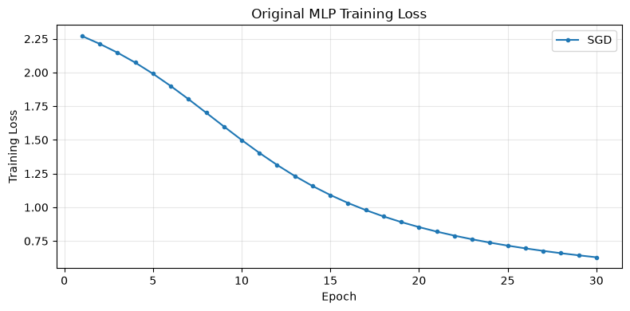
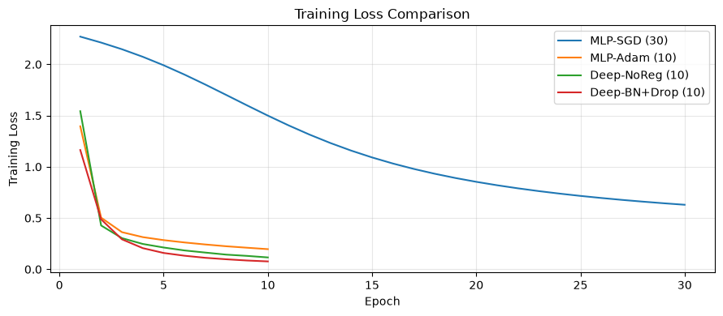
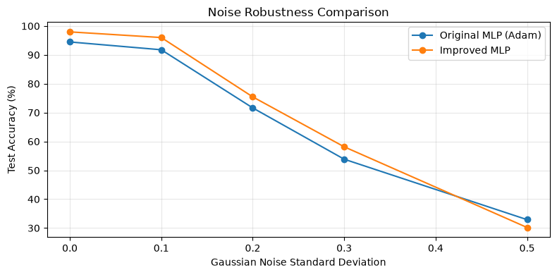

# 实验四：MLP多层感知机手写数字识别

## 一、实验目的

1. 理解多层感知机（MLP）的基本结构和工作原理，掌握全连接层、激活函数、损失函数以及反向传播算法的基本概念。
2. 熟悉 PyTorch 深度学习框架，掌握 MNIST 手写数字数据集的加载、预处理、模型构建、训练和测试过程。
3. 使用 SGD 优化器完成基础 MLP 网络训练，并通过训练损失曲线和测试准确率分析模型的学习效果。
4. 在基础实验上进行模型改进，对比 SGD 与 Adam 优化器的收敛表现，研究网络深度、Batch Normalization 和 Dropout 对分类性能的影响。
5. 利用混淆矩阵、误分类样本分析、噪声鲁棒性测试和数值梯度检查，从多个角度评价模型性能，加深对神经网络训练及泛化能力的理解。

## 二、实验环境与数据集

### 2.1 实验环境

本实验使用 Python 语言和 PyTorch 深度学习框架，在 Jupyter Notebook 中编写、运行和调试实验代码。

### 2.2 MNIST 数据集

MNIST 是经典的手写数字识别数据集，共包含 70,000 张手写数字灰度图像，其中训练集 60,000 张，测试集 10,000 张。每张图像的大小为 28×28 像素，包含数字 0～9 共 10 个类别。

实验使用 TorchVision 加载数据集，并通过 `transforms.ToTensor()` 将图像转换为张量，同时将像素值归一化至 `[0,1]` 区间。

```python
transform = transforms.Compose([transforms.ToTensor()])

train_data = datasets.MNIST(
    root="data", train=True, download=True, transform=transform
)
test_data = datasets.MNIST(
    root="data", train=False, download=True, transform=transform
)
```

为了观察数据集的基本特征，从每个数字类别中选取一个样本进行可视化。


从图1可以看出，不同数字具有较为明显的笔画结构差异，但部分数字存在书写倾斜、笔画连接和形态相似等特点。

## 三、实验步骤

### 3.1 构建基础 MLP 网络

按照实验参考代码，首先构建一个包含输入层、隐藏层和输出层的多层感知机网络。基础 MLP 的实现代码如下：

```python
class MLP(nn.Module):
    def __init__(self):
        super().__init__()
        self.l1 = nn.Linear(784, 128)
        self.l2 = nn.Linear(128, 10)

    def forward(self, x):
        a1 = self.l1(x)
        x1 = F.relu(a1)
        a2 = self.l2(x1)
        return a2
```

模型首先对输入图像进行线性变换，再使用 ReLU 函数引入非线性特征，最后通过第二个全连接层输出 10 个类别的预测分数。

### 3.2 基础模型训练与测试

使用 SGD 优化器训练基础 MLP，训练过程包括梯度清零、前向传播、损失计算、反向传播及参数更新。

```python
torch.manual_seed(SEED)
model = MLP().to(device)

optimizer = optim.SGD(model.parameters(), lr=0.01)

base_hist, base_result, base_time = fit(
    model, optimizer, 30, "Original MLP + SGD"
)
```

训练时记录每轮的平均交叉熵损失，训练结束后使用测试集计算最终损失和分类准确率。

### 3.3 SGD 与 Adam 优化器对比

在完成基础模型训练后，为研究不同优化算法对模型收敛效果的影响，进一步使用 Adam 优化器进行对照实验。

Adam 通过对梯度一阶矩和二阶矩进行估计，自适应调整参数更新幅度，通常能够改善部分神经网络训练初期的收敛表现。实验保持基础 MLP 的网络结构不变，将优化器更换为 Adam，学习率设置为 0.001，训练 10 轮。

```python
torch.manual_seed(SEED)
adam_model = MLP().to(device)

adam_hist, adam_result, adam_time = fit(
    adam_model,
    optim.Adam(adam_model.parameters(), lr=0.001),
    10,
    "Original MLP + Adam"
)
```

通过固定随机种子，使两组模型具有相同的初始参数，并对比前 10 轮的训练损失变化。

### 3.4 深层 MLP 网络改进

为了提高网络对复杂手写数字特征的表达能力，在基础模型之上增加隐藏层，将网络结构修改为：

**784 → 256 → 128 → 64 → 10**

同时引入以下改进：

1. **GELU 激活函数：** 替代原有的 ReLU，为网络提供更加平滑的非线性变换。
2. **Batch Normalization：** 对隐藏层特征进行归一化，改善网络训练过程。
3. **Dropout：** 在训练阶段随机屏蔽部分神经元，降低模型对特定特征组合的依赖。

改进模型核心代码如下：

```python
class DeepMLP(nn.Module):
    def __init__(self, use_bn=True, dropout=0.3):
        super().__init__()

        self.fc1 = nn.Linear(784, 256)
        self.fc2 = nn.Linear(256, 128)
        self.fc3 = nn.Linear(128, 64)
        self.fc4 = nn.Linear(64, 10)

        self.bn1 = nn.BatchNorm1d(256) if use_bn else nn.Identity()
        self.bn2 = nn.BatchNorm1d(128) if use_bn else nn.Identity()
        self.bn3 = nn.BatchNorm1d(64) if use_bn else nn.Identity()
        self.drop = nn.Dropout(dropout)

    def forward(self, x):
        x = self.drop(F.gelu(self.bn1(self.fc1(x))))
        x = self.drop(F.gelu(self.bn2(self.fc2(x))))
        x = F.gelu(self.bn3(self.fc3(x)))
        return self.fc4(x)
```

### 3.5 分类性能评价与误分类分析

为了更加全面地评价模型的分类效果，除了整体准确率，还计算混淆矩阵以及 Precision、Recall、F1-score 指标。

进一步筛选改进模型中预测错误的样本，根据 Softmax 预测置信度从高到低排序，选取其中 10 张高置信度误分类图像进行可视化。

### 3.6 高斯噪声鲁棒性实验

为了研究模型在受到图像噪声干扰时的稳定性，对测试集添加不同强度的高斯噪声。

### 3.7 数值梯度检查

为了验证梯度计算的正确性，使用 NumPy 构建简单的 Softmax 分类器，并采用中心差分法对一个权重参数进行数值梯度检查。

实验中设定 \(h=10^{-5}\)，分别计算解析梯度和数值梯度，并通过相对误差判断两者是否一致。

## 四、实验结果与分析

### 4.1 基础 MLP 网络训练结果

基础模型使用 SGD 优化器训练 30 轮，训练日志显示，模型损失随训练轮数增加而逐渐降低。

部分训练结果如下：

| Epoch |   训练损失 |
| ----- | -----: |
| 1     | 2.2703 |
| 5     | 1.9907 |
| 10    | 1.4995 |
| 15    | 1.0913 |
| 20    | 0.8534 |
| 25    | 0.7159 |
| 30    | 0.6295 |


从上图可以观察到，基础 MLP 的训练损失随着训练轮数增加持续下降，由第1轮的 2.2703 降至第30轮的 0.6295。

在训练前期，模型损失下降较快；随着训练逐渐进行，曲线下降速度减缓，说明网络参数正在逐步向较低损失的区域调整。

基础模型最终测试结果为：

| 指标    |      结果 |
| ----- | ------: |
| 测试损失  |  0.5995 |
| 测试准确率 |  86.26% |
| 训练时间  | 245.8 s |

从实验结果可以看出，虽然基础 MLP 网络结构较为简单，但经过反向传播和 SGD 优化后，已经能够识别大部分手写数字。

### 4.2 SGD 与 Adam 优化器收敛效果分析

通过比较 SGD 和 Adam 在前 10 轮中的训练损失，研究不同优化配置的收敛速度。


两组模型的部分训练结果如下：

| Epoch | SGD Loss | Adam Loss |
| ----- | -------: | --------: |
| 1     |   2.2703 |    1.3952 |
| 5     |   1.9907 |    0.2844 |
| 10    |   1.4995 |    0.1962 |

从上图可以看出，Adam 优化器的损失下降速度明显快于当前学习率设置下的 SGD。在第10轮训练结束后，SGD 的训练损失仍为 1.4995，而 Adam 已经降低到 0.1962。

这表明，在本实验配置下，Adam 能够在较少的训练轮数内取得更好的训练收敛效果。此外，Adam 模型仅训练 10 轮便取得了 94.48% 的测试准确率，而基础 SGD 模型在训练 30 轮后准确率为 86.26%。

### 4.3 不同网络结构的训练效果对比

在优化器对比的基础上，进一步比较浅层 MLP、深层 MLP 和引入 BN、Dropout 后的改进模型。



从上图可以看出，四组模型的训练损失均随训练轮数增加而下降，但收敛速度存在明显差异。这说明在本次实验中，深层网络结合归一化与 Dropout 的设计能够取得更好的训练效果。

### 4.4 不同模型分类准确率分析

对四组模型的最终测试结果进行汇总：

| 模型                | Epoch |   测试损失 |  测试准确率 |    训练时间 |
| ----------------- | ----: | -----: | -----: | ------: |
| MLP + SGD         |    30 | 0.5995 | 86.26% | 245.8 s |
| MLP + Adam        |    10 | 0.1941 | 94.48% |  85.2 s |
| Deep MLP（NoReg）   |    10 | 0.1215 | 96.18% |  85.3 s |
| Deep MLP（BN+Drop） |    10 | 0.0687 | 97.97% |  88.3 s |


综合以上结果，**Deep MLP + BatchNorm + Dropout 是本次实验中测试准确率最高的模型**。

### 4.5 混淆矩阵与分类性能分析

为更加详细地分析改进模型对不同数字类别的识别效果，绘制了测试集的混淆矩阵。


混淆矩阵中，纵轴表示真实类别，横轴表示预测类别。从图中可以看出，绝大多数样本集中在主对角线上，表明模型能够正确分类大部分数字。

为了更加全面地评价模型的分类能力，进一步计算 Precision、Recall 和 F1-score。
实验结果如下：

| 评价指标            |     结果 |
| --------------- | -----: |
| Accuracy        | 97.97% |
| Macro Precision | 0.9798 |
| Macro Recall    | 0.9795 |
| Macro F1-score  | 0.9796 |

从结果可以看出，改进 MLP 不仅整体识别准确率较高，而且对不同数字类别具有相对均衡的分类能力，没有出现明显的类别整体识别失效情况。

### 4.6 错误分类样本分析

为进一步研究模型产生分类错误的原因，从测试集中选取预测错误且置信度较高的10张图像，展示其真实标签、预测标签和预测置信度。


从图中可以看出，错误分类的数字往往存在笔画形态不规范、局部轮廓相似或数字书写方式特殊等情况。

### 4.7 高斯噪声鲁棒性分析

为了分析模型对图像干扰的适应能力，在测试图像中加入不同强度的高斯噪声，并比较浅层 Adam MLP 与改进 MLP 的识别准确率。

实验结果如下：

| 噪声标准差 | 浅层 MLP（Adam） | 改进 MLP |
| ----- | -----------: | -----: |
| 0.0   |       94.48% | 97.97% |
| 0.1   |       91.77% | 96.01% |
| 0.2   |       71.63% | 75.45% |
| 0.3   |       53.85% | 58.15% |
| 0.5   |       32.91% | 30.19% |



从图中可以看出，两种模型的分类准确率均随着噪声强度增加而逐渐降低。说明，**在干净测试集上具有更高准确率的模型，并不一定在所有噪声条件下都具有更好的鲁棒性**。

## 五、实验小结

本次实验围绕多层感知机手写数字识别任务，完成了 MNIST 数据集加载、图像预处理、神经网络构建、模型训练以及测试集分类评价等基本实验内容。

首先，按照实验参考代码构建了 `784 → 128 → 10` 的基础 MLP 网络，使用 ReLU 激活函数、SGD 优化器和交叉熵损失函数训练30轮，最终在 MNIST 测试集上获得了 86.26% 的准确率。通过训练损失曲线可以看出，模型能够随着训练轮数增加不断降低损失，说明网络可以通过反向传播学习有效的数字特征。在基础实验上，进一步开展了优化器对比、深层网络改进以及 Batch Normalization 和 Dropout 联合消融实验。实验结果表明，Adam 优化器在当前配置下具有更快的早期收敛速度；增加网络深度能够进一步提高特征表达能力；引入 BN 和 Dropout 后，改进 MLP 的测试准确率最终达到 97.97%，Macro F1-score 达到 0.9796，取得了本次实验中较好的分类效果。

随后，通过混淆矩阵和错误分类样本分析，进一步观察到模型在面对不规范手写数字时仍可能出现误分类，甚至产生高置信度的错误预测。高斯噪声鲁棒性实验则表明，模型在正常图像上的高准确率并不意味着其在强噪声条件下仍能保持稳定的识别性能。改进 MLP 在噪声标准差为 0.5 时，准确率下降至 30.19%，说明模型的鲁棒性仍有进一步提升空间。此外，通过数值梯度检查验证了简化 Softmax 分类器中所选参数的梯度计算正确性，加深了对损失函数、梯度计算和反向传播过程的理解。

通过本次实验，我不仅掌握了 PyTorch 中 MLP 的基本训练流程，也进一步认识到网络结构、优化算法和正则化方法对模型性能的重要影响。在实际的图像分类任务中，不能只关注最终准确率，还需要结合训练收敛过程、误分类情况、分类指标及噪声鲁棒性等多个角度进行综合分析。

后续可以在当前实验的基础上引入数据增强、学习率调度以及卷积神经网络（CNN），并通过多次重复实验和独立验证集进行更加全面的比较，进一步提高模型的识别准确率与泛化能力。

