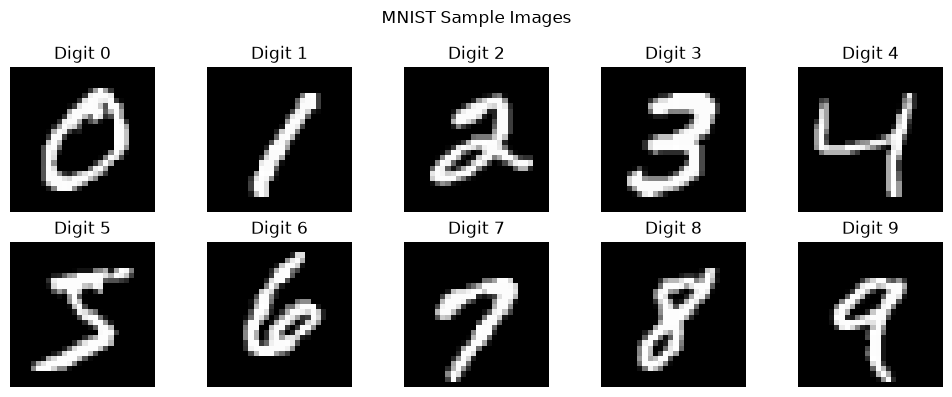
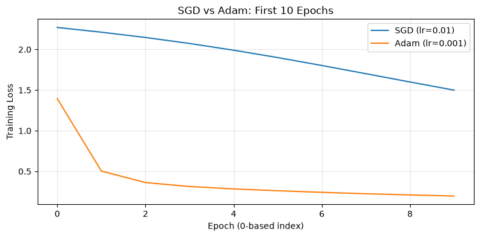
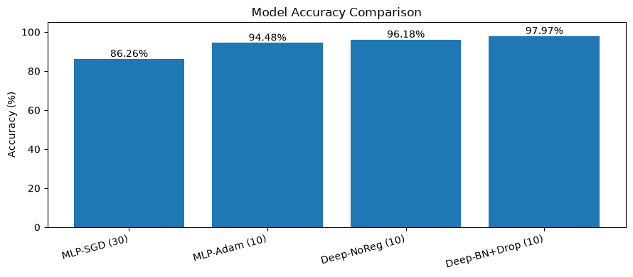
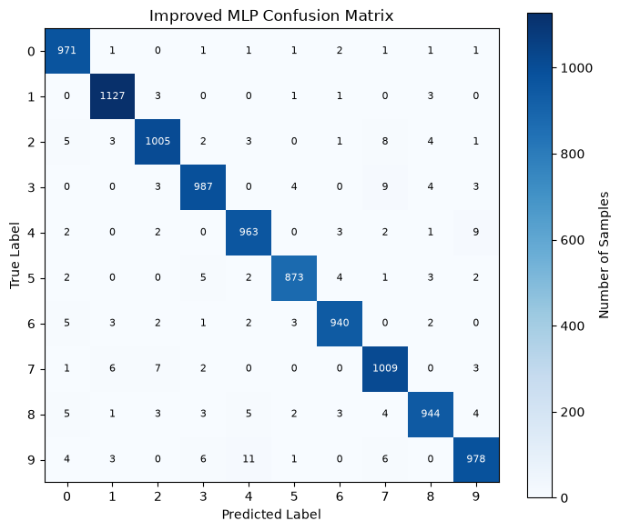
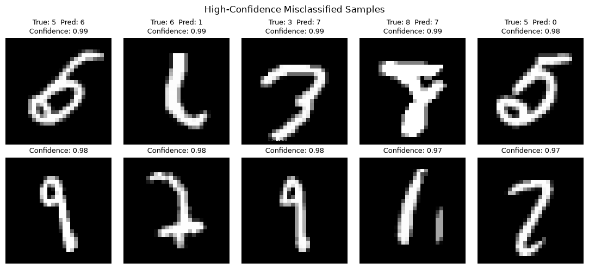

# 实验四：MLP多层感知机手写数字识别

## 一、实验目的

1. 理解多层感知机（MLP）的基本结构和工作原理，掌握全连接层、激活函数、损失函数以及反向传播算法的基本概念。
2. 熟悉 PyTorch 深度学习框架，掌握 MNIST 手写数字数据集的加载、预处理、模型构建、训练和测试过程。
3. 使用 SGD 优化器完成基础 MLP 网络训练，并通过训练损失曲线和测试准确率分析模型的学习效果。
4. 在基础实验上进行模型改进，对比 SGD 与 Adam 优化器的收敛表现，研究网络深度、Batch Normalization 和 Dropout 对分类性能的影响。
5. 利用混淆矩阵、误分类样本分析、噪声鲁棒性测试和数值梯度检查，从多个角度评价模型性能，加深对神经网络训练及泛化能力的理解。

## 二、实验环境与数据集

开发平台：Python 3.14 + Jupyter Notebook

依赖库：PyTorch（MLP 神经网络构建、自动求导、反向传播及模型训练）、TorchVision（MNIST 数据集加载与图像预处理）、NumPy（数值计算、混淆矩阵统计及梯度检查）、Matplotlib（手写数字样本、训练损失曲线、分类准确率、混淆矩阵及噪声鲁棒性结果可视化）

测试素材：MNIST 手写数字数据集，包含 60,000 张训练图像和 10,000 张测试图像，每张图像为 28×28 像素的灰度图像，涵盖数字 0～9 共 10 个类别，用于多层感知机的训练、手写数字分类、模型性能对比及高斯噪声鲁棒性实验。

```python
transform = transforms.Compose([transforms.ToTensor()])

train_data = datasets.MNIST(
    root="data", train=True, download=True, transform=transform
)
test_data = datasets.MNIST(
    root="data", train=False, download=True, transform=transform
)
```


## 三、实验步骤

### 3.1 构建基础 MLP 网络

按照实验参考代码，首先构建一个包含输入层、隐藏层和输出层的多层感知机网络。基础 MLP 的实现代码如下：

```python
class MLP(nn.Module):
    def __init__(self):
        super().__init__()
        self.l1 = nn.Linear(784, 128)
        self.l2 = nn.Linear(128, 10)

    def forward(self, x):
        a1 = self.l1(x)
        x1 = F.relu(a1)
        a2 = self.l2(x1)
        return a2
```

模型首先对输入图像进行线性变换，再使用 ReLU 函数引入非线性特征，最后通过第二个全连接层输出 10 个类别的预测分数。

### 3.2 基础模型训练与测试

使用 SGD 优化器训练基础 MLP，训练过程包括梯度清零、前向传播、损失计算、反向传播及参数更新。

```python
torch.manual_seed(SEED)
model = MLP().to(device)

optimizer = optim.SGD(model.parameters(), lr=0.01)

base_hist, base_result, base_time = fit(
    model, optimizer, 30, "Original MLP + SGD"
)
```

训练时记录每轮的平均交叉熵损失，训练结束后使用测试集计算最终损失和分类准确率。

### 3.3 SGD 与 Adam 优化器对比

在完成基础模型训练后，为研究不同优化算法对模型收敛效果的影响，进一步使用 Adam 优化器进行对照实验。

Adam 通过对梯度一阶矩和二阶矩进行估计，自适应调整参数更新幅度，通常能够改善部分神经网络训练初期的收敛表现。

实验保持基础 MLP 的网络结构不变，将优化器更换为 Adam，学习率设置为 0.001，训练 10 轮。通过固定随机种子，使两组模型具有相同的初始参数，并对比前 10 轮的训练损失变化。


```python
torch.manual_seed(SEED)
adam_model = MLP().to(device)

adam_hist, adam_result, adam_time = fit(
    adam_model,
    optim.Adam(adam_model.parameters(), lr=0.001),
    10,
    "Original MLP + Adam"
)
```

### 3.4 深层 MLP 网络改进

1.为了提高网络对复杂手写数字特征的表达能力，在基础模型之上增加隐藏层，将网络结构修改为：
**784 → 256 → 128 → 64 → 10**
2. **GELU 激活函数：** 替代原有的 ReLU，为网络提供更加平滑的非线性变换。
3. **Batch Normalization：** 对隐藏层特征进行归一化，改善网络训练过程。
4. **Dropout：** 在训练阶段随机屏蔽部分神经元，降低模型对特定特征组合的依赖。

改进模型核心代码如下：
```python
class DeepMLP(nn.Module):
    def __init__(self, use_bn=True, dropout=0.3):
        super().__init__()

        self.fc1 = nn.Linear(784, 256)
        self.fc2 = nn.Linear(256, 128)
        self.fc3 = nn.Linear(128, 64)
        self.fc4 = nn.Linear(64, 10)

        self.bn1 = nn.BatchNorm1d(256) if use_bn else nn.Identity()
        self.bn2 = nn.BatchNorm1d(128) if use_bn else nn.Identity()
        self.bn3 = nn.BatchNorm1d(64) if use_bn else nn.Identity()
        self.drop = nn.Dropout(dropout)

    def forward(self, x):
        x = self.drop(F.gelu(self.bn1(self.fc1(x))))
        x = self.drop(F.gelu(self.bn2(self.fc2(x))))
        x = F.gelu(self.bn3(self.fc3(x)))
        return self.fc4(x)
```

### 3.5 分类性能评价与误分类分析

为了更加全面地评价模型的分类效果，除了整体准确率，还计算混淆矩阵以及 Precision、Recall、F1-score 指标。

进一步筛选改进模型中预测错误的样本，根据 Softmax 预测置信度从高到低排序，选取其中 10 张高置信度误分类图像进行可视化。

### 3.6 高斯噪声鲁棒性实验

为了研究模型在受到图像噪声干扰时的稳定性，对测试集添加不同强度的高斯噪声。

### 3.7 数值梯度检查

为了验证梯度计算的正确性，使用 NumPy 构建简单的 Softmax 分类器，并采用中心差分法对一个权重参数进行数值梯度检查。

## 四、实验结果与分析

### 4.1 基础 MLP 网络训练结果

基础模型使用 SGD 优化器训练 30 轮，训练日志显示，模型损失随训练轮数增加而逐渐降低。


从上图可以观察到，基础 MLP 的训练损失随着训练轮数增加持续下降，由第1轮的 2.2703 降至第30轮的 0.6295。在训练前期，模型损失下降较快；随着训练逐渐进行，曲线下降速度减缓，说明网络参数正在逐步向较低损失的区域调整。

基础模型最终测试结果为：
| 指标    |      结果 |
| ----- | ------: |
| 测试损失  |  0.5995 |
| 测试准确率 |  86.26% |
| 训练时间  | 245.8 s |

### 4.2 SGD 与 Adam 优化器收敛效果分析

通过比较 SGD 和 Adam 在前 10 轮中的训练损失，研究不同优化配置的收敛速度。



从上图可以看出，Adam 优化器的损失下降速度明显快于当前学习率设置下的 SGD。在第10轮训练结束后，SGD 的训练损失仍为 1.4995，而 Adam 已经降低到 0.1962。这表明，在本实验配置下，Adam 能够在较少的训练轮数内取得更好的训练收敛效果。此外，Adam 模型仅训练 10 轮便取得了 94.48% 的测试准确率，而基础 SGD 模型在训练 30 轮后准确率为 86.26%。

### 4.3 不同网络结构的训练效果对比

在优化器对比的基础上，进一步比较浅层 MLP、深层 MLP 和引入 BN、Dropout 后的改进模型。


从上图可以看出，四组模型的训练损失均随训练轮数增加而下降，但收敛速度存在明显差异。这说明在本次实验中，深层网络结合归一化与 Dropout 的设计能够取得更好的训练效果。

### 4.4 不同模型分类准确率分析

对四组模型的最终测试结果进行汇总：

| 模型                | Epoch |   测试损失 |  测试准确率 |    训练时间 |
| ----------------- | ----: | -----: | -----: | ------: |
| MLP + SGD         |    30 | 0.5995 | 86.26% | 245.8 s |
| MLP + Adam        |    10 | 0.1941 | 94.48% |  85.2 s |
| Deep MLP（NoReg）   |    10 | 0.1215 | 96.18% |  85.3 s |
| Deep MLP（BN+Drop） |    10 | 0.0687 | 97.97% |  88.3 s |


综合以上结果，**Deep MLP + BatchNorm + Dropout 是本次实验中测试准确率最高的模型**。

### 4.5 混淆矩阵与分类性能分析

1.为更加详细地分析改进模型对不同数字类别的识别效果，绘制了测试集的混淆矩阵。



混淆矩阵中，纵轴表示真实类别，横轴表示预测类别。从图中可以看出，绝大多数样本集中在主对角线上，表明模型能够正确分类大部分数字。

2.为了更加全面地评价模型的分类能力，进一步计算 Precision、Recall 和 F1-score。
实验结果如下：

| 评价指标            |     结果 |
| --------------- | -----: |
| Accuracy        | 97.97% |
| Macro Precision | 0.9798 |
| Macro Recall    | 0.9795 |
| Macro F1-score  | 0.9796 |

从结果可以看出，改进 MLP 不仅整体识别准确率较高，而且对不同数字类别具有相对均衡的分类能力，没有出现明显的类别整体识别失效情况。

### 4.6 错误分类样本分析

为进一步研究模型产生分类错误的原因，从测试集中选取预测错误且置信度较高的10张图像，展示其真实标签、预测标签和预测置信度。



从图中可以看出，错误分类的数字往往存在笔画形态不规范、局部轮廓相似或数字书写方式特殊等情况。

### 4.7 高斯噪声鲁棒性分析

为了分析模型对图像干扰的适应能力，在测试图像中加入不同强度的高斯噪声，并比较浅层 Adam MLP 与改进 MLP 的识别准确率。

实验结果如下：

| 噪声标准差 | 浅层 MLP（Adam） | 改进 MLP |
| ----- | -----------: | -----: |
| 0.0   |       94.48% | 97.97% |
| 0.1   |       91.77% | 96.01% |
| 0.2   |       71.63% | 75.45% |
| 0.3   |       53.85% | 58.15% |
| 0.5   |       32.91% | 30.19% |


从图中可以看出，两种模型的分类准确率均随着噪声强度增加而逐渐降低。

## 五、实验小结
通过本次实验，我对多层感知机的结构和神经网络的训练过程有了更加深入的理解。以前学习神经网络时，我更多是从理论上了解前向传播、反向传播和梯度下降等概念，对它们在实际训练中是如何发挥作用的还不够清楚。这次通过自己使用 PyTorch 搭建 MLP 网络，完成 MNIST 数据集的加载、模型训练和测试，我逐渐理解了数据是如何经过全连接层得到预测结果，以及模型如何通过计算损失和反向传播不断调整参数。

在完成基础实验后，我尝试通过更换优化器、增加网络层数以及引入 Batch Normalization 和 Dropout 来改进模型。通过对比实验，我发现不同的网络结构和训练方法对最终结果有着很大的影响。基础 MLP 的准确率为 86.26%，而经过改进后，模型的准确率提升到了 97.97%。这个过程让我体会到，神经网络并不是简单地搭建好模型就能获得理想的结果，还需要根据实际训练情况不断进行调整和优化。同时，我也认识到模型并不是越复杂就一定越好，只有结合训练损失、准确率和实际测试效果，才能更合理地判断一种改进方法是否有效。让我印象比较深刻的是误分类分析和噪声鲁棒性实验。刚开始看到改进模型接近 98% 的准确率时，我认为模型已经能够很好地完成手写数字识别任务，但在观察错误分类样本后，我发现一些在人眼看来能够辨认的数字，模型仍然可能判断错误，甚至对错误结果给出很高的置信度。而在加入高斯噪声后，模型的准确率又出现了明显下降，特别是在噪声较强时，改进模型的表现甚至不如结构更简单的模型。

总的来说，这次实验让我收获最大的不仅是学会了使用 PyTorch 构建和训练神经网络，更重要的是逐渐学会了如何通过设计对比实验、观察可视化结果和分析实验数据来理解模型的表现。我也发现，实验并不是只要程序能够运行、得到较高的准确率就算完成，更重要的是弄清楚为什么会得到这样的结果，以及模型还有哪些不足。
